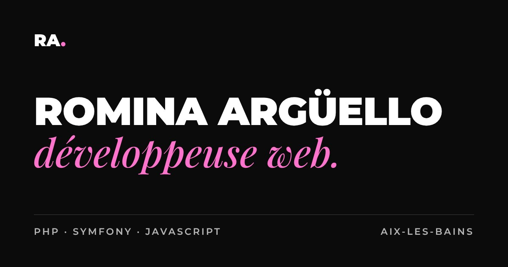

# Romina Argüello — Portfolio

Portfolio professionnel de **Romina Argüello**, développeuse web (titre Développeur Web et Web Mobile, ENI École Informatique).

🔗 **Site :** [romina-arguello.website](https://romina-arguello.website)



## Contenu

- **Page d'accueil** : présentation, compétences, projets, graphisme, parcours et contact.
- **Étude de cas** : [La Petite Batellerie](projets/la-petite-batellerie.html), boutique e-commerce Symfony réalisée en stage (contexte, conception UML, architecture, sécurité, tests, bilan).
- **CV** téléchargeable au format PDF.
- **Mentions légales**.

## Stack technique

| Domaine | Outils |
|---|---|
| Structure et style | HTML5 sémantique, CSS3 (variables, Grid, Flexbox, BEM), Bootstrap 5.3 |
| Interactions | JavaScript (vanilla) |
| Animations | GSAP 3 (ScrollTrigger, SplitText, ScrambleText), Lenis (smooth scroll) |
| Versionnement | Git, GitHub (Conventional Commits) |

## Architecture

```
├── index.html
├── projets/la-petite-batellerie.html   # étude de cas
├── mentions-legales.html
├── robots.txt / sitemap.xml            # SEO
└── assets/
    ├── css/
    │   ├── fonts.css        # polices auto-hébergées
    │   ├── base.css         # variables (design tokens), reset, typographie, accessibilité
    │   ├── layout.css       # header, sections, footer
    │   ├── components.css   # composants réutilisables (boutons, tags…)
    │   ├── sections.css     # styles propres à chaque section
    │   ├── case-study.css   # pages d'étude de cas
    │   ├── animations.css   # styles liés aux animations
    │   └── vendor/          # Bootstrap
    ├── js/
    │   ├── nav.js           # navigation (header au scroll, menu mobile)
    │   ├── main.js          # bouton retour en haut, copie de l'e-mail, année du footer
    │   ├── animations.js    # toutes les animations GSAP
    │   └── vendor/          # bibliothèques externes (non modifiées)
    ├── fonts/               # Montserrat, Playfair Display (woff2)
    └── img/
```

## Bonnes pratiques mises en œuvre

- **Accessibilité** : HTML sémantique, hiérarchie des titres, lien d'évitement, `aria-*`, focus visible au clavier, contrastes vérifiés (WCAG AA), aucune animation si l'utilisateur a activé « réduire les animations » (`prefers-reduced-motion`).
- **Amélioration progressive** : le site est complet et lisible sans JavaScript ; les animations s'ajoutent par-dessus.
- **Performance** : images en WebP aux dimensions adaptées, chargement différé (`loading="lazy"`), scripts en `defer`, n'animer que `transform` et `opacity`.
- **RGPD** : polices et bibliothèques hébergées localement, aucun cookie, aucun traceur, aucune donnée transmise à des tiers.
- **SEO** : balises `title` et `description`, Open Graph, données structurées (fil d'Ariane Schema.org), `sitemap.xml`.
- **Sécurité** : liens externes en `rel="noopener"`, insertion de texte avec `textContent` (pas d'`innerHTML`).

## Lancer le projet en local

Aucune installation n'est nécessaire : ouvrir `index.html` avec un serveur local (par exemple l'extension **Live Server** de VS Code).

> La copie de l'adresse e-mail (API Clipboard) nécessite un contexte sécurisé : `https://` ou `localhost` / `127.0.0.1`.

## Historique

- `v1.0` : première version du portfolio (formation DWWM).
- `v2.0` : refonte complète (architecture, design, contenus, animations), développée sur la branche `refonte-v2` puis fusionnée dans `main` par Pull Request.

## Hébergement

Le site est hébergé chez **DonWeb** ; la branche `main` correspond à la version en ligne.

## Outils utilisés

Conformément aux exigences de transparence de ma formation, je déclare l'usage d'un outil d'intelligence artificielle :

- **Claude (Anthropic)** a été utilisé comme assistant tout au long de la refonte : proposition d'architecture et de code, explications détaillées des concepts, relecture et tests.
- Chaque proposition a été **lue, comprise, testée et validée** par moi avant d'être intégrée. Les contenus ont été rédigés ou validés à partir de mes propres documents, et les choix de design (couleurs, typographies, animations) sont les miens.
- Les commits ont été réalisés par moi.

## Crédits et licences

- [GSAP](https://gsap.com) (ScrollTrigger, SplitText, ScrambleText) — licence standard GSAP (gratuite)
- [Lenis](https://github.com/darkroomengineering/lenis) — licence MIT
- [Bootstrap](https://getbootstrap.com) — licence MIT
- Polices [Montserrat](https://fonts.google.com/specimen/Montserrat) et [Playfair Display](https://fonts.google.com/specimen/Playfair+Display) — SIL Open Font License 1.1

## Contact

**Romina Argüello** — [romina.arg.dev@gmail.com](mailto:romina.arg.dev@gmail.com) · [LinkedIn](https://www.linkedin.com/in/romina-arguello/) · [GitHub](https://github.com/Romina-Arguello)
